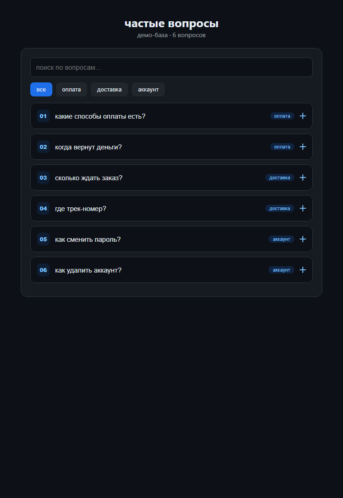

# w3-faq-api — вопросы и ответы с API

Проект 3 из web-серии: аккордеон + API + поиск.
Ванилла без библиотек, открывается двойным кликом.

## что умеет

- тянет 12 вопросов с jsonplaceholder (без ключа), категории, поиск с подсветкой
- аккордеон: номер, пилюля категории, плюсик крутится, открыт один
- ответ — врезка с акцентом; каскадное появление, ховер-подъем
- без сети — встроенная база из 6 вопросов (демо: `?demo=1`)
- fetch с таймаутом 8с, `?shot=1` гасит анимации для скрина

## проверка логики

`node A:\TEMP\w3_check.js` — `logic ok` (маппинг, фильтр, подсветка, тоггл).

## скрин

